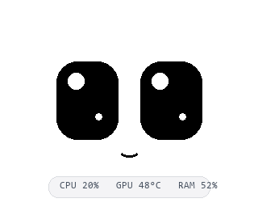
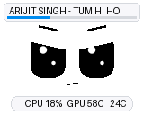
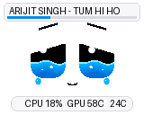
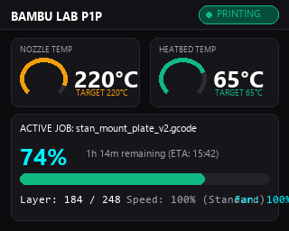
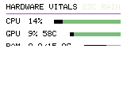
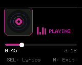

# STΔN studio. - ESP32 3D Printer Monitor and Autonomous Desk Companion

[]()
[]()
[](https://platformio.org/)
[]()
[](https://web-tau-five-60.vercel.app/)
[](https://dashboard.render.com/)
[](https://python.org)
[]()
[](LICENSE)

An embedded firmware for ESP32 powering an autonomous desk companion, Bambu Lab 3D printer telemetry monitor, PC hardware HUD, and synchronized media visualizer with an ST7735 1.8-inch TFT display.

For the in-depth hardware, wiring, and driver troubleshooting manual, see [docs/SETUP_GUIDE.md](docs/SETUP_GUIDE.md).

---

## Feature Status & Architecture Matrix

| Subsystem / Feature | Status | Core / Runtime | Protocol / Interface | Highlights |
|---|---|---|---|---|
| **LovyanGFX Vector Pipeline** | 🟢 Production | ESP32 Core 1 | Hardware VSPI (40 MHz DMA) | Double-buffered 160×128 rendering at 100 FPS with anti-aliasing |
| **Bambu Lab Telemetry Engine** | 🟢 Production | ESP32 Core 0 | MQTT over SSL/TLS (Port 8883) | Live nozzle/bed thermals, layer counts, print progress %, and fan status |
| **Autonomous Desk Pet** | 🟢 Production | ESP32 Core 1 | Parametric Squircle & Bezier Easing | 11 parametric emotional states with dynamic Disney eyelid easing |
| **Beat & Genre Audio Engine** | 🟢 Production | Windows (WASAPI) | 44.1 kHz FFT & Autocorrelation | Real-time dance choreography & genre classification (Hip-Hop, EDM, Rock) |
| **PC Hardware Monitor HUD** | 🟢 Production | Windows Host | HTTP REST (`/api/pc/stats`) | CPU, GPU, RAM utilization, and thermals pushed every second |
| **AI Cognitive Cortex** | 🟢 Production | Host / Cloud | NVIDIA NIM (Nemotron & Mistral) | Zero-cold-start inference, thermal sentinels, layer milestone analysis |
| **Local Admin Server & Proxy** | 🟢 Production | Python 3.10+ | Port 3000, PNA/CORS reverse proxy | Auto-probes ESP32 IP and serves dashboard with zero browser blocks |
| **Web PWA & RLE Screen Stream** | 🟢 Production | Browser / Vercel | RLE delta compression, WebSockets | visionOS dark UI, live screen mirror, RGB color wheel, D-Pad |
| **MicroSD FAT File Explorer** | 🟢 Production | ESP32 Core 0 | HSPI (GPIO 13/15/25/26) | Remote SD card file browser, asset management, and OTA updates |
| **Render Cloud Backend** | 🟢 Deployed | Render Cloud | Python 3.11 / FastAPI | 24/7 cloud fallback for AI inference and Spotify token refresh |
| **Automated Test Suite & QA** | 🟢 Production | Python 3.10+ | `unittest` (`run_tests.py`) | 26 unit tests covering backend APIs, audio rules, asset pipelines & CLI tools |
| **Private Network Access (PNA)** | 🟢 Production | Chrome / Edge | Chromium Security Flags / Script | Seamless cross-origin bypass for public Vercel PWA to private ESP32 IP |

---

## What is New in Phase 2

Phase 2 transitions the system from a passive 3D printer monitor into an active, multi-modal autonomous desktop companion.

| Feature Area | Phase 1 (Legacy Telemetry Monitor) | Phase 2 (Autonomous Desk Pet and Studio) |
|---|---|---|
| Primary Role | Dedicated Bambu Lab MQTT monitor | Dual-engine: Bambu telemetry plus autonomous companion |
| Display Pipeline | Standard Adafruit GFX canvas at 15-20 FPS | LovyanGFX double-buffered vector pipeline at 100 FPS |
| Desk Pet Engine | Not present | 11 parametric emotional states with Disney eyelid easing |
| Music Visualization | Not present | WASAPI loopback audio beat analyzer and beat-pattern genre classifier with 100 FPS dance engine |
| AI Cognition | Not present | NVIDIA NIM Autonomous Cognitive Cortex with zero-cold-start inference and proactive sentinels |
| PC Telemetry | Not present | Real-time CPU, GPU, RAM, and thermals HUD |
| Sleep Progression | Fixed screen timeout | Dynamic daytime ladder (5m drowsy, 7m yawn, 8m sleep, 12m deep sleep) |
| Web Platform | Basic status text endpoint | visionOS-inspired mobile PWA with live RLE display mirror |
| Storage and OTA | Basic SD mount | Full FAT32 file manager, SD asset loading, and Web OTA |
| Audio Feedback | Single beep tones | Non-blocking PWM audio engine with state-specific chirps |

---

## Visual Overview

### Autonomous Desk Pet and Mood Engine
The desk companion runs at 100 FPS on FreeRTOS Core 1, rendering anti-aliased squircles and expressive parametric eyelids.

| Neutral State | Dance Vibe (Hip-Hop) | Cry Response |
|---|---|---|
|  |  |  |

| Rage / Warning | Calm State |
|---|---|
|  |  |

### Telemetry and Media Integration

| Bambu 3D Printer Monitor | PC Hardware HUD | Spotify / Media Visualizer |
|---|---|---|
|  |  |  |

---

## System Architecture

```
+-------------------------------------------------------------------------+
|                               HOST PC / MOBILE                          |
|                                                                         |
|  +---------------------------+       +-------------------------------+  |
|  |   spotify_desk_sync.py    |       |   STΔN studio. Web PWA        |  |
|  |  (Windows Media + psutil) |       |  (Mobile Chrome / Safari)     |  |
|  +-------------+-------------+       +---------------+---------------+  |
+----------------|-------------------------------------|------------------+
                 | HTTP POST /api/spotify/now          | HTTP GET/POST
                 | HTTP POST /api/pc/stats             | WebSocket / RLE
                 v                                     v
+-------------------------------------------------------------------------+
|                                ESP32 FIRMWARE                           |
|                                                                         |
|  Core 0 (Networking and Services):                                      |
|    - FreeRTOS HTTP Server (REST API, RLE Screen Streamer, Web OTA)      |
|    - Bambu Lab MQTT Client (SSL/TLS, JSON payload parser)               |
|    - WiFi Station Manager and Reconnection Loop                         |
|                                                                         |
|  Core 1 (Graphics and Real-Time Interaction):                           |
|    - LovyanGFX 100 FPS Vector Rendering Pipeline                       |
|    - Autonomous Pet State Machine (11 Moods, Eyelid Blinks, Sleep)      |
|    - Genre-Aware Vibe Engine (Hip-Hop, Drill, Rock, EDM, Lo-Fi)         |
|    - Non-blocking PWM Tone Generator                                    |
|    - Hardware Debounced Button Interrupt Handlers                       |
+-------------------------------------------------------------------------+
                 | SPI (40 MHz)      | SPI (4 MHz)     | GPIO
                 v                   v                 v
          +-------------+     +-------------+   +---------------+
          | ST7735 LCD  |     | MicroSD FAT |   | WS2812B / Spk |
          |  (160x128)  |     | File System |   | Menu / Select |
          +-------------+     +-------------+   +---------------+
```

---

## Hardware Pinout and Wiring

Target board: ESP32 DevKit v1 (30-pin, dual-core Tensilica Xtensa LX6 @ 240 MHz).

### ST7735 1.8-inch TFT Display (SPI)
| Display Pin | ESP32 GPIO | Description |
|---|---|---|
| VCC | 3.3V or 5V | Power supply (matches module regulator) |
| GND | GND | Ground |
| CS | GPIO 5 | Chip Select |
| RESET | GPIO 4 | Hardware Reset |
| A0 / DC | GPIO 2 | Data / Command Control |
| SDA / MOSI | GPIO 23 | VSPI MOSI (Hardware SPI) |
| SCK / SCLK | GPIO 18 | VSPI SCK (Hardware SPI @ 40 MHz) |
| LED / BL | 3.3V | Backlight power |

### MicroSD Card Reader (HSPI)
| MicroSD Pin | ESP32 GPIO | Description |
|---|---|---|
| CS | GPIO 15 | HSPI Chip Select |
| SCK | GPIO 25 | Software/Hardware SPI Clock |
| MOSI | GPIO 13 | Master Out Slave In |
| MISO | GPIO 26 | Master In Slave Out |
| VCC | 3.3V / 5V | Power supply |
| GND | GND | Ground |

### Peripherals and Inputs
| Component | ESP32 GPIO | Configuration |
|---|---|---|
| Menu Button | GPIO 4 | Active LOW, internal pull-up |
| Select Button | GPIO 16 | Active LOW, internal pull-up |
| Status LED | GPIO 27 | WS2812B Addressable RGB strip |
| Buzzer | GPIO 14 | Passive buzzer driven by LEDC PWM |

---

## Desk Pet Emotional States and Timing

The autonomous pet operates on an internal state machine driven by sensory triggers, incoming telemetry, and idle timers:

| Mood State | Trigger Condition | Visual Appearance |
|---|---|---|
| Neutral | Default idle state | Wide open squircle eyes with specular highlights |
| Happy | Print success / Good thermals | Inverted arc smiling eyes with bouncing cheeks |
| Sad | Print failure / Low PC memory | Lowered gaze with bottom specular glints |
| Crying | Critical error / Print cancel | Solid crystal anime blue body with tear flow |
| Angry | High CPU/GPU temp (>85C) | Crimson body with diagonal aggressive brows |
| Surprised | Sudden telemetry delta | Enlarged pupils with raised curved brows |
| Wink | Button click confirmation | Asymmetric single eye wink with smirk |
| Sleepy | 5 minutes idle (300s) | Half-lidded drooping eyelids |
| Yawning | 7 minutes idle (420s) | Elliptical mouth expansion with eye squint |
| Sleeping | 8 minutes idle (480s) | Closed curved eye slots with slow breath cycle |
| Deep Sleep | 12 minutes idle (720s) | Pulsing sZz indicator with minimal redraws |

Wakeup triggers: Any physical button press, incoming music packet, print state transition, or REST API call resets the idle timer immediately to 0.

---

## Music Dance and Beat Pattern Audio Analysis

The desk companion features a real-time Audio Beat Pattern Analyzer (`tools/audio_beat_analyzer.py`) and media sync daemon (`tools/spotify_desk_sync.py`). It captures Windows desktop audio loopback via WASAPI at 44.1 kHz, decomposes frequency bands via FFT, tracks kick onsets, estimates BPM via autocorrelation, and classifies beat patterns directly from acoustic energy:

- EDM / Party (Style 2): Detected via continuous 4-on-the-floor kick regularity at 120-138 BPM. Companion executes a 10.0px double-hop bounce, wide alert gaze, and happy upturned smile.
- Hip-Hop / Drill / Trap (Style 1): Detected via dominant 808 sub-bass drops (30-80 Hz) and half-time intervals (65-88 BPM). Companion executes an 11.0px deep head nod, cocked attitude brow, and swagger smirk.
- Rock / Metal (Style 3): Detected via sustained high-mid saturation (800-3500 Hz guitar overdrive) and driving 110-180 BPM tempo. Companion executes a 13.5px vertical headbang with sharp determined brow furrow.
- Lo-Fi / Chill (Style 4): Detected via warm low-mids, attenuated treble (>5 kHz rolloff), and mellow tempo (70-95 BPM). Companion executes a 4.5px gentle sinusoidal sway with relaxed eyelid curves.
- Acoustic / Ballad (Style 5): Detected via slow tempo (<68 BPM) and sparse acoustic transients. Companion executes a 2.5px slow breathing rhythm with steady gaze.
- Pop / Commercial (Style 0): Detected via balanced rhythmic transients at 95-125 BPM. Companion executes a joyful upbeat bounce.

The audio engine runs automatically inside `tools/spotify_desk_sync.py` or standalone via `python tools/audio_beat_analyzer.py` with an interactive terminal HUD.

---

## Autonomous AI Cognitive Cortex (NVIDIA NIM)

The desk pet incorporates an autonomous cognitive cortex (`tools/pet_ai_cortex.py`) powered by NVIDIA NIM inference microservices. The AI transforms the device from a passive display into an active desktop sentinel that observes hardware telemetry, diagnoses print errors, and responds interactively.

### Zero Cold-Start Architecture
Serverless LLM endpoints frequently suffer from cold-start latency (2 to 8 seconds) due to weight eviction and TLS handshakes. The cortex eliminates this through:
- Persistent Connection Pooling: HTTP keep-alive connection reuse eliminates repeated SSL/TLS negotiation overhead.
- Asynchronous Pre-Warm Ping: On startup, a micro-token is dispatched in a background thread, ensuring container weights are memory-resident before user queries or telemetry events fire.
- Autonomous Keep-Alive Pulse: A background heartbeat fires every 240 seconds during idle periods to prevent serverless pod shutdown.
- Dual-Model Cascade: Uses `nvidia/nemotron-3.5-bolt-e4b` for sub-400ms rapid reflexes, with automated fallback to `mistralai/mistral-large-4-1t-a52b` for complex multi-step diagnostics.

### Autonomous Cognitive Sentinels
The cortex runs three background sentinels that autonomously actuate the physical device:
1. 3D Print Sentinel:
   - Thermal Guard: Detects nozzle drops below 190C during active printing. Triggers warning tone, sets alarmed face, and displays diagnosis banner.
   - Progress Milestones: Evaluates layer completion at 25%, 50%, 75%, and 90%, formulating extrusion and cooling assessments.
   - Lifecycle Events: Triggers energetic celebration on print start/finish, or failure post-mortem on aborted prints.
2. PC Hardware Sentinel:
   - GPU Thermal Throttling Guard: Alerts with angry face if GPU exceeds 82C.
   - Late-Night Coding Watchdog: Triggers yawns and reminders to rest when intense compute occurs past 1:00 AM.
3. Music Critic:
   - Automatically formulates a 1-sentence critique matching the detected beat pattern whenever tracks change.

### Conversational Interface
Users can interact with the companion directly:
- Command Line: `python tools/talk_to_pet.py "How is my print doing?"` or double-click `tools/chat_with_stan.bat`.
- Physical Actuation: The AI morphs the companion face (`/api/pet/mood`), displays a cyan banner on the 160x128 screen (`/api/notify`), and speaks aloud via native Windows speech synthesis.

---

## REST API Reference

The ESP32 runs a multi-threaded HTTP server on port 80.

### Pet and Mood Control
- `POST /api/pet/mood`: Update mood manually.
  - Body: `{"mood": "happy"}` (Options: neutral, happy, sad, crying, angry, surprised, wink, sleepy, yawn, sleeping, deep_sleep)
- `GET /api/pet/mood`: Read current mood and idle ticks.
  - Response: `{"mood": "neutral", "idle_ms": 12400, "fps": 99.8}`

### Media and PC Telemetry Push
- `POST /api/spotify/now`: Push current playback metadata and vibe style.
  - Body: `{"track": "Song Title", "artist": "Artist", "is_playing": true, "genre": "hip-hop", "bpm": 140}`
- `POST /api/pc/stats`: Push PC hardware monitor statistics.
  - Body: `{"cpu_pct": 24, "gpu_pct": 42, "ram_pct": 58, "cpu_temp": 48.5, "gpu_temp": 52.0}`

### Remote Display and Framebuffer
- `GET /api/control/screen`: Fetch full 160x128 16-bit BMP framebuffer capture.
- `GET /api/control/screen_rle`: Stream run-length encoded (RLE) delta stream for web canvas mirror.

### System and Management
- `GET /api/status`: Return WiFi RSSI, free heap, printer connection state, and temperatures.
- `POST /api/control/button`: Inject virtual button click (`{"button": "menu"}` or `{"button": "select"}`).
- `POST /update`: Multipart firmware upload for Web OTA flashing.

---

## Installation and Setup

For a full step-by-step wiring guide, display offset troubleshooting, and environment configuration, refer to the [Setup & Deployment Guide](docs/SETUP_GUIDE.md).

### 1. Build and Flash Firmware with PlatformIO
Clone the repository and compile the firmware:
```bash
git clone https://github.com/mxsourav/bambu-telemetry-dashboard.git
cd bambu-telemetry-dashboard
pio run
```
Connect your ESP32 via USB and flash:
```bash
pio run -t upload
```
*Note: To target a specific serial port, pass `--upload-port COM11`.*

### 2. Autonomous Companion Daemon (Zero-Command Master Launch)
Install host dependencies:
```bash
pip install winsdk psutil requests urllib3 soundcard numpy scipy
```
Double-click `STAN_AUTONOMOUS_START.bat` in the repository root. This autonomously:
1. Verifies and turns on the Windows Mobile Hotspot (`192.168.137.1`).
2. Registers a silent Windows Startup task (`tools/start_sync_silent.vbs`) for boot persistence.
3. Launches the unified background daemon: WASAPI beat pattern analyzer, media sync, PC telemetry HUD, and NVIDIA AI Cortex.
4. Activates auto-sleep when you leave your desk (>5 min idle), and auto-wakes with a greeting upon return.

To chat with your desk companion at any time, run `TALK_TO_STAN.bat` or:
```bash
python tools/talk_to_pet.py "Your message here"
```
To stop all background processes:
```bash
STAN_STOP.bat
```

### 3. Localhost Admin Panel & Reverse Proxy
For a seamless, zero-config local dashboard experience without private network browser blocks:
```bash
START_ADMIN_PANEL.bat
```
This launches `tools/admin_server.py`, which:
- Automatically probes and identifies the ESP32 IP on your subnet.
- Hosts the web dashboard at `http://localhost:3000/`.
- Injects Private Network Access (PNA) and CORS headers so the browser can freely communicate with the ESP32.

### 4. Cloud Web PWA & Vercel Deployment
Deploy the visionOS web dashboard to Vercel:
```bash
npm i -g vercel
cd web
vercel --prod
```
When accessing the hosted app (`https://web-tau-five-60.vercel.app/`):
- Run `AUTO_SETUP_VERCEL.bat` to launch Chrome/Edge/Brave with `--unsafely-treat-insecure-origin-as-secure` flags.
- Alternatively, open `chrome://flags` -> enable **Insecure origins treated as secure** -> add your ESP32 IP (`http://192.168.137.35`).

### 5. Render 24/7 Cloud Backend Gateway
Deploy the Python FastAPI backend to Render using Blueprint:
1. In [Render Dashboard](https://dashboard.render.com/), select **New +** -> **Blueprint**.
2. Connect `bambu-telemetry-dashboard` (Render reads `backend/render.yaml`).
3. Set environment variables: `NVIDIA_API_KEY`, `SPOTIFY_CLIENT_ID`, `SPOTIFY_CLIENT_SECRET`.
4. The service will be live at `https://stan-desk-station-backend.onrender.com`.

### 6. Spotify Integration & Token Pairing
To authenticate Spotify for permanent headless playback tracking:
```bash
Pair_Spotify_Permanent.bat
```
Follow the browser authorization prompt; OAuth credentials will be cached in `.spotify_cache.json`.

### 7. Automated Testing & Verification Suite
STΔN studio includes an automated verification runner to test backend API endpoints, music classification rules, asset generation pipelines, and CLI argument parsers:
```bash
# Install developer requirements
pip install -r requirements-dev.txt

# Run automated test suite
python run_tests.py
```
This runs 26 unit tests and validates that embedded headers (`src/web_ui.h`) remain perfectly synchronized with source assets (`web/index.html`).

---

## License

This project is open-source under the MIT License.
